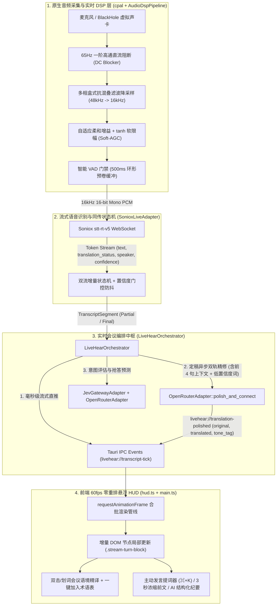

# LiveHear 系统架构与技术规范 (System Architecture & Specification)

本文档定义 **LiveHear** 的端到端系统架构、音频数字信号处理（DSP）管线、Soniox `stt-rt-v5` 实时双流状态机、LLM 上下文双轨精修与 Co-Pilot 协议，以及前端 60fps 零布局抖动 HUD 渲染规范。

---

## 1. 全局分层架构

LiveHear 遵循严格的 **整洁架构（Clean Architecture）** 与 **端口-适配器模式（Ports & Adapters）**，将底层硬件采集、流式网络状态机、大模型推理编排与前端高频渲染解耦：



---

## 2. 目录与模块职责

```text
livehear/
├── livehear.config.example.json       # 标准配置模板与字段规范
├── src/                               # 前端视图与状态控制层 (TypeScript + Vite)
│   ├── main.ts                        # 全局状态、Tauri 事件总线、rAF 渲染调度与交互绑定
│   ├── components/
│   │   └── hud.ts                     # 悬浮 HUD 视图模板、快捷语种浮层、划词卡片与设置弹窗
│   ├── types/
│   │   └── domain.ts                  # 与 Rust 后端 100% 对齐的领域模型与 FullAppConfig 接口
│   └── styles/
│       ├── tokens.css                 # 视觉 Token (深空毛玻璃、圆角、阴影、色彩规范)
│       └── app.css                    # GPU 合成动画与响应式 HUD 组件样式
└── src-tauri/                         # 原生后端核心 (Rust / Tauri v2)
    └── src/
        ├── lib.rs                     # Tauri 插件注册、全局状态容器与 IPC Command 路由表
        ├── config.rs                  # AppConfig 多环境加载、默认值与自动版本迁移
        ├── domain/                    # 纯粹领域实体层 (零外部 I/O 依赖)
        │   ├── transcript.rs          # TranscriptSegment (含 confirmed/provisional 双流与低置信度词)
        │   ├── speaker.rs             # SpeakerId、SpeakerRole 与 UI 展示映射
        │   ├── intent.rs              # MeetingIntent 与 JevDecision 决策模型
        │   ├── suggestion.rs          # ReplyStrategy 与双语建议卡片实体
        │   └── error.rs               # LiveHearError 统一错误类型
        ├── services/                  # 核心基础设施与外部 AI 适配器
        │   ├── audio_capture.rs       # cpal 多设备采集、AudioDspPipeline 与 VadGate 环形预卷
        │   ├── asr/
        │   │   └── soniox.rs          # Soniox stt-rt-v5 WebSocket 双流状态机与置信度防抖
        │   ├── ai/
        │   │   └── openrouter.rs      # LLM 双轨上下文纠偏、语气标注、划词精译、提词与纪要生成
        │   └── gate/
        │       └── jev.rs             # Jev 1.13 毫秒级意图分类网关与本地启发式降级
        ├── orchestrator/
        │   └── mod.rs                 # 异步编排器 (多轮上下文窗口维护、句尾语义融合、并发派发)
        └── commands/
            └── mod.rs                 # 前端 invoke 命令处理器 (音频控制、隐身/穿透、AI 智囊、导出)
```

---

## 3. 核心子系统技术规范

### 3.1 原生音频 DSP 与智能 VAD 管线 ([`audio_capture.rs`](file:///Users/sexy/Documents/GitHub/livehear/src-tauri/src/services/audio_capture.rs))

1. **设备枚举与定向绑定**：
   - `NativeAudioCapture::list_input_devices()` 枚举系统所有可用输入设备（含 `BlackHole 2ch`、聚合设备、外置麦克风），标记系统默认设备。
   - 支持在设置中选择特定音源，保存后热重启采集流。
2. **三阶实时 DSP 处理 (`AudioDspPipeline`)**：
   - **高通直流阻断 (`dc_blocker_alpha = 0.9915`)**：传递函数 $y[n] = x[n] - x[n-1] + \alpha y[n-1]$，切除 65Hz 以下环境低频噪声。
   - **多相抗混叠积分降采样**：对高于 16kHz 的硬件采样率（如 48kHz / 44.1kHz），在分数步长窗口内对所有多相采样点进行盒式积分均值化（Boxcar Anti-Aliasing Filter），防止高频齿音混叠到低频语音频段。
   - **自适应柔和自动增益 (`Soft-AGC`)**：跟踪语音活跃帧的指数移动平均包络（`running_rms_env`），目标 RMS 为 `0.11`，最大增益上限 `3.2x`（避免放大底噪），输出端经 $\tanh(x \cdot 1.1) / 1.1$ 软限幅保护。
3. **零截断智能静音门禁 (`VadGate`)**：
   - 维护 500ms（16000 字节）`VecDeque<u8>` 环形预卷缓冲区。
   - 静音期每 160ms 发送一帧全零心跳包保持 Soniox WebSocket 活跃并推进服务端时钟；一旦瞬时信噪比突破阈值，立即将 500ms 预卷缓冲连同当前帧一并冲刷上送，并保持 1400ms 尾音延续（Hangover），确保句首爆破音与句尾轻声词完整无损。

---

### 3.2 Soniox `stt-rt-v5` 双流状态机与防抖规范 ([`soniox.rs`](file:///Users/sexy/Documents/GitHub/livehear/src-tauri/src/services/asr/soniox.rs))

1. **WebSocket 握手协议**：
   - 支持 `model: "stt-rt-v5"`，音频格式固定为 `pcm_s16le`（16kHz 单声道）。
   - `language_hints` 配合 `language_hints_strict: true` 将声学解码空间严格收敛在用户指定的语种集合内。
   - `context.terms` 注入用户自定义专业术语表（`custom_terms`）与会议背景词。
   - `translation` 支持 `one_way`（`target_language`）与 `two_way`（`language_a` ↔ `language_b`）。
2. **双流增量缓冲区（Confirmed + Provisional）**：
   - **原文流**（`translation_status` 为 `"original"` 或 `"none"`）：`is_final: true` 的 Token 记入 `confirmed_orig`（不可变锚点），`is_final: false` 的 Token 记入当前帧 `provisional_orig`。
   - **译文流**（`translation_status` 为 `"translation"`）：`is_final: true` 记入 `confirmed_trans`，`is_final: false` 记入 `provisional_trans`。
   - 推向前端的 `TranscriptSegment` 同时携带 `confirmed_text` + `provisional_text` 与 `confirmed_translated_text` + `provisional_translated_text`，前端对已锁定前缀与流式跳动后缀进行分层染色渲染，彻底消除流式识别跳字闪烁。
3. **置信度门控说话人防抖（Confidence-Gated Diarization Hysteresis）**：
   - 当识别到新 `speaker` 标签时，若该 Token 为纯标点、常见英文/中文高频短虚词，或其声学置信度 `confidence < 0.62`，状态机拒绝立即切换说话人，需连续累积 `>= 2` 个高置信度实词 Token 才确认角色切换。
4. **低置信度词汇追踪 (`low_confidence_words`)**：
   - 对 `is_final: true` 且 `confidence < 0.78` 的实词 Token 自动去重记录到 `TranscriptSegment.low_confidence_words`，供下游 LLM 靶向纠偏。

---

### 3.3 语义合并与 LLM 双轨后处理协议 ([`orchestrator/mod.rs`](file:///Users/sexy/Documents/GitHub/livehear/src-tauri/src/orchestrator/mod.rs) & [`openrouter.rs`](file:///Users/sexy/Documents/GitHub/livehear/src-tauri/src/services/ai/openrouter.rs))

1. **跨包语义平滑与碎片融合**：
   - 编排器维护最近每位说话人的定稿快照与 최근 6 轮对话历史窗口（`recent_context_window`）。
   - 当同一说话人在 `6500ms` 内连续定稿，且上一句以未完结连接词（如 `and/but/because/which/因为/但是/如果`）结尾或当前句为短碎片时，自动执行跨句语义拼接。
2. **双轨上下文纠偏与语气感知 (`polish_and_connect`)**：
   - 输入：前 4 句多轮对话记录、当前句原文、Soniox 初步译文、低置信度疑似误识词列表、会议背景与术语表。
   - 输出 JSON 契约：`{"original": "纠偏后的通顺原文", "translated": "地道母语级译文", "tone_tag": "语气标签或null"}`。
   - 完成后通过 `livehear://translation-polished` 事件无感替换对应字幕块的原文、译文并挂载语气徽章（`.turn-tone-tag`）。
3. **交互式 AI 智囊接口**：
   - `lookup_selection`：针对用户双击或划选的词句，结合所在原句与会议背景返回 `{"term", "phonetic", "meaning", "context_explanation"}`。
   - `generate_copilot_prompts`：基于最近对话上下文与用户可选意图提示，生成 3 条带中英双语对照的口语发言稿（直接回应 / 补充推进 / 委婉周旋）。
   - `summarize_recent_context`：3 秒提炼最近对话的 3 条核心脉络要点（TL;DR）。
   - `generate_meeting_minutes`：将整场会议双语记录与用户时间轴笔记（`📌 记笔记`）合成为结构化 Markdown 纪要。

---

### 3.4 窗口隐身、穿透与 60fps 渲染架构 ([`commands/mod.rs`](file:///Users/sexy/Documents/GitHub/livehear/src-tauri/src/commands/mod.rs) & [`main.ts`](file:///Users/sexy/Documents/GitHub/livehear/src/main.ts))

1. **系统级窗口保护**：
   - `set_stealth_mode(enabled)`：调用 `WebviewWindow::set_content_protected(enabled)`，使窗口在屏幕录制与会议桌面共享流中被合成器剥离。
   - `set_click_through(enabled)`：调用 `WebviewWindow::set_ignore_cursor_events(enabled)`，开启后窗口不拦截任何鼠标点击事件。
2. **60fps 零重排 DOM 渲染管线**：
   - 高频流式事件（每秒 15~30 次 `transcript-tick` 与音量事件）不直接操作完整列表，而是写入内存状态并通过 `requestAnimationFrame` 合批（Coalescing）。
   - 仅对发生变化的 `.stream-turn-block` 节点执行局部 DOM 属性与文本更新，配合 CSS `contain: content` 与 GPU `transform: translateZ(0)` 合成层隔离，保持 CPU 占用率低于 3%。
