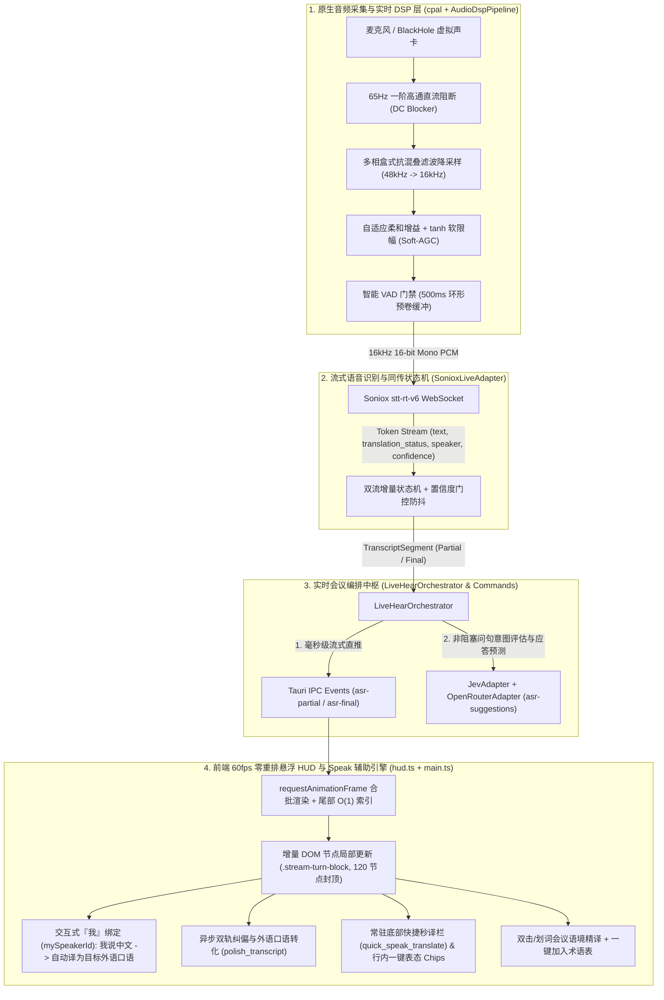

# LiveHear 系统架构与技术规范 (System Architecture & Specification)

本文档定义 **LiveHear** 的端到端系统架构、音频数字信号处理（DSP）管线、Soniox `stt-rt-v6` 实时双流状态机、LLM 上下文双轨精修与 Co-Pilot 协议，以及前端 60fps 零布局抖动 HUD 渲染规范。

---

## 1. 全局分层架构

LiveHear 遵循严格的 **整洁架构（Clean Architecture）** 与 **端口-适配器模式（Ports & Adapters）**，将底层硬件采集、流式网络状态机、大模型推理编排与前端高频渲染解耦：



---

## 2. 目录与模块职责

```text
livehear/
├── .github/workflows/
│   └── build-windows.yml              # GitHub Actions 云端自动构建 Windows (.exe NSIS / .msi) 流水线
├── livehear.config.example.json       # 标准配置模板与字段规范 (含 target_language 与 speak_target_language)
├── src/                               # 前端视图与状态控制层 (TypeScript + Vite)
│   ├── main.ts                        # 全局状态、Tauri 事件总线、rAF 渲染调度、Speak 辅助路由与内存封顶保护
│   ├── components/
│   │   └── hud.ts                     # 悬浮 HUD 视图模板、快捷语种浮层、Quick Speak Dock、划词卡片与设置弹窗
│   ├── types/
│   │   └── domain.ts                  # 与 Rust 后端 100% 对齐的领域模型、FullAppConfig 与 QuickSpeakResult 接口
│   └── styles/
│       ├── tokens.css                 # 视觉 Token (深空毛玻璃、圆角、阴影、色彩规范)
│       └── app.css                    # GPU 合成动画、跨平台红黄绿灯自适应避让与响应式 HUD 组件样式
└── src-tauri/                         # 原生后端核心 (Rust / Tauri v2)
    └── src/
        ├── lib.rs                     # Tauri 插件注册、全局状态容器与 IPC Command 路由表
        ├── config.rs                  # AppConfig 多环境加载、默认值与自动版本迁移
        ├── domain/                    # 纯粹领域实体层 (零外部 I/O 依赖)
        │   └── mod.rs                 # TranscriptSegment、Speaker、MeetingIntent、ReplySuggestion 与 LiveHearError
        ├── services/                  # 核心基础设施与外部 AI 适配器
        │   ├── audio_capture.rs       # cpal 多设备采集、AudioDspPipeline 与 VadGate 环形预卷
        │   ├── asr/
        │   │   └── soniox.rs          # Soniox stt-rt-v6 WebSocket 双流状态机与置信度防抖
        │   └── ai/
        │       ├── openrouter.rs      # LLM 双轨上下文纠偏、我方中文转外语口语、快捷输入秒译、划词精译、提词与纪要
        │       └── jev.rs             # Jev 毫秒级意图分类网关与本地启发式降级
        ├── orchestrator/
        │   └── mod.rs                 # 异步编排器 (FIFO 终态有序队列、非阻塞问句检测与状态广播)
        └── commands/
            └── mod.rs                 # 前端 invoke 命令处理器 (音频控制、隐身/穿透、Speak 秒译、AI 智囊、导出)
```

---

## 3. 核心子系统技术规范

### 3.1 原生音频 DSP 与智能 VAD 管线 ([`audio_capture.rs`](file:///Users/sexy/Documents/GitHub/livehear/src-tauri/src/services/audio_capture.rs))

1. **设备枚举与定向绑定**：
   - `list_input_devices()` 枚举系统所有可用输入设备（含 `BlackHole 2ch`、Loopback、聚合设备、外置麦克风），标记系统默认设备。
   - 支持在设置中选择特定音源，保存后热重启采集流。
2. **三阶实时 DSP 处理 (`AudioDspPipeline`)**：
   - **高通直流阻断 (`highpass_dc_block`, $\alpha = 0.991$)**：传递函数 $y[n] = x[n] - x[n-1] + 0.991 y[n-1]$，切除 65Hz 以下环境低频震动与空调轰鸣。
   - **多相抗混叠积分降采样**：对高于 16kHz 的硬件采样率（如 48kHz / 44.1kHz），在每个 16kHz 目标采样周期内按精确时间权重积分求均值（Boxcar Anti-Aliasing Low-Pass Filter），防止高频清辅音折叠混叠到低频语音频段。
   - **自适应柔和自动增益 (`Soft-AGC`)**：跟踪语音活跃帧 RMS，自动拉升远场微弱人声（最高 `2.8x`），超过 `0.82` 幅值时经 `tanh` 软限幅保护。
3. **零截断智能静音门禁 (`VadGate`)**：
   - 维护 500ms（5 × 100ms 帧）`VecDeque<Vec<u8>>` 环形预卷缓冲区与 3800ms 尾音保持窗口（Hangover）。
   - 当说话人停顿超过尾音窗口进入静默时，自动向 Soniox 推流协程发送 `VAD_FINALIZE_SIGNAL`（触发官方 `{"type":"finalize","trailing_silence_ms":300}` 指令立即锁定尾句与译文），并在静音期由写协程每 8 秒发送 `{"type":"keepalive"}` 保活；一旦再次检测到人声，立即将 500ms 预卷缓冲冲刷上送，确保字首清辅音零丢失。

---

### 3.2 Soniox `stt-rt-v6` 双流状态机与防抖规范 ([`soniox.rs`](file:///Users/sexy/Documents/GitHub/livehear/src-tauri/src/services/asr/soniox.rs))

1. **WebSocket 握手协议**：
   - 支持 `model: "stt-rt-v6"`，音频格式固定为 `pcm_s16le`（16kHz 单声道）。
   - `max_endpoint_delay_ms` 设置断句等待上限，`endpoint_sensitivity` 调整语义断句的触发倾向。
   - `language_hints` 配合 `language_hints_strict: true` 将声学解码空间严格收敛在用户指定的语种集合内。
   - `context` 同时注入会议主题 (`general.topic`)、声学偏置术语表 (`terms`) 与专有译名映射 (`translation_terms`)。
   - `translation` 支持：
     - `one_way`（`target_language`，默认 `"zh"`，搭配前端 Speak 辅助引擎实现「听会全转中文 + 我说中文自动译为目标外语」）；
     - `two_way`（`speak_target_language` ↔ `target_language` 双向互译）。
2. **双流增量缓冲区（Confirmed + Provisional）**：
   - **原文流**：`is_final: true` 的 Token 记入 `pending_final_orig`（不可变锚点），`is_final: false` 的 Token 记入当前帧 `prov_orig`。
   - **译文流**（`translation_status == "translation"`）：`is_final: true` 记入 `pending_final_trans`，`is_final: false` 记入 `prov_trans`。
   - 推向前端的 `TranscriptSegment` 同时携带 `confirmed_text` + `provisional_text` 与 `confirmed_translated_text` + `provisional_translated_text`，前端分层染色渲染，消除跳字闪烁。
3. **置信度门控说话人防抖（Confidence-Gated Diarization Hysteresis）**：
   - 仅由 `token.is_final && !is_trans && confidence >= 0.62` 的已确认原声 Token 驱动说话人切换。
   - 句末边界处要求新说话人连续累积 `>= 4` 字符或 `>= 2` 个 Token 才切换；半句中间（无句末标点且未触发端点）要求连续 `>= 15` 字符或 `>= 4` 个 Token 才允许切句，彻底吸收句中 1~3 词的声纹抖动与短促附和词。
4. **语义完整性保持窗 (`incomplete_hold_since`) 与低置信度词追踪 (`low_confidence_words`)**：
   - 当 `<end>` 触发但当前累积原声尚属未完短句或以连词/介词结尾时，开启 `2.4s` 续航保持窗等待说话人继续说完。
   - 对 `is_final: true` 且 `confidence < 0.78` 的实词自动记录到 `low_confidence_words`，供下游 LLM 靶向纠偏。

---

### 3.3 交互式 Speak 辅助引擎与 LLM 双轨后处理协议 ([`openrouter.rs`](file:///Users/sexy/Documents/GitHub/livehear/src-tauri/src/services/ai/openrouter.rs) & [`main.ts`](file:///Users/sexy/Documents/GitHub/livehear/src/main.ts))

1. **交互式「我」身份绑定与非对称双语路由 (`mySpeakerId` + `speak_target_language`)**：
   - 用户在 HUD 字幕流点击任意发言人的头像、连续圆点或 `👆 设为我` 按钮，即可将该 `speakerId` 绑定为 `mySpeakerId`（顶栏实时显示 `🎙️ 我: Speaker X ✕`）。
   - **他人发言 (`speakerId !== mySpeakerId`)**：外语由 Soniox 实时同传为 `target_language`（默认中文），定稿后触发 `polish_and_connect(..., target_lang = None)` 进行 ASR 听写纠偏与中文润色；若触发问句则由 `JevAdapter` 弹出应答建议。
   - **「我自己」发言 (`speakerId === mySpeakerId`)**：
     - 当检测到「我」说**中文**时：`scheduleTurnPolish` 立即调用 `translateTurnToForeign`（即 `polish_transcript(..., targetLang = speak_target_language)`），在纠偏中文原声的同时将其转化为地道的目标外语口语（如英文）并就地双语展示，方便用户直接看着屏幕照念。
     - 当检测到「我」说**英语/外语**时：保留外语原声与中文同传对照，并在 `asr-suggestions` 监听器中自动拦截过滤，绝不针对自己说的话弹出抢答建议。
2. **常驻底部「快捷输入秒译 & 辅助发言栏」(Quick Speak Dock)**：
   - `quick_speak_translate(text, target_lang)` 只用当前输入生成纯文本译文，并自动写入剪贴板。`quick_translate_model` 可指定独立的秒译模型。
   - `generate_copilot_prompts(recent_history, user_intent, target_lang)`：支持从底部输入框按 `Shift+Enter` 或点击任意字幕行内的态度按钮（`👍 赞同` / `⏳ 缓议` / `❓ 追问` / `💬 接话`），围绕指定单句与意图生成 3 条不同策略的目标外语发言卡片。
3. **交互式词典与结构化纪要接口**：
   - `lookup_selection`：双击单词或划选短语时，结合所在原句与会议背景返回音标/句型、核心释义、语境潜台词解读及 `原词=译名` 术语对，支持一键热写入 `custom_terms`。
   - `summarize_recent_context`：3 秒提炼最近 14 轮对话的 3 条核心脉络要点（TL;DR）。
   - `generate_meeting_minutes`：将最近 120 轮双语记录与用户时间轴笔记（`📌 记笔记`）合成为结构化高管摘要、核心决议与 Action Items。

---

### 3.4 窗口隐身、穿透、内存封顶与 60fps 渲染规范 ([`commands/mod.rs`](file:///Users/sexy/Documents/GitHub/livehear/src-tauri/src/commands/mod.rs) & [`main.ts`](file:///Users/sexy/Documents/GitHub/livehear/src/main.ts))

1. **系统级窗口保护与跨平台适配**：
   - `set_stealth_mode(enabled)`：调用 `WebviewWindow::set_content_protected(enabled)`，使窗口在屏幕录制与会议桌面共享流中被操作系统合成器剥离。
   - `set_click_through(enabled)`：调用 `WebviewWindow::set_ignore_cursor_events(enabled)`，开启后窗口不拦截鼠标点击。
   - 自动检测运行平台（`data-platform="macos" | "windows" | "linux"`），在 macOS 下预留左侧 `74px` 原生红黄绿灯避让区，在 Windows/Linux 下自动紧凑对齐。
2. **60fps 零重排 DOM 渲染与长稳内存封顶保护**：
   - **rAF 帧合并 (`SubtitleStreamManager`)**：高频流式 `asr-partial` 事件通过 `requestAnimationFrame` 合批，同 ID 节点使用 `replaceWith` 配合 `animation: none` 就地零闪烁更新。
   - **三级容量封顶与尾部 $O(1)$ 检索**：
     - DOM 节点封顶：`cullOldNodes()` 严格限制 `#subtitlesStream` 内最多保留最新 `120` 个 `.stream-turn-block` 节点。
     - 实时缓存封顶：`pushSubtitleWithCap()` 限制 `hudState.subtitles` 最多保留 `1000` 条记录，移出的记录按顺序写入 Rust 管理的本地临时 JSONL 归档；写入失败时保留内存副本并提示。导出先取得归档与实时缓存的一致快照，等待 AI 摘要期间的新发言不会改变该快照。清空字幕同时清空归档，正常退出时删除临时文件。`coalesceMap` 限制最多保留 `64` 条活跃合并绑定，`translatingTurnIds` 防重集合对同句并发请求去重。
     - 尾部逆序查找：`findSubtitleIndexById()` 从数组末尾向前扫描，使流式 Partial/Final 帧的状态匹配保持 $O(1)$ 常数级耗时。

---

## 4. 开源生态调研与架构对照

| 开源项目 | 技术栈 | 核心能力 | LiveHear 的融合与超越 |
| :--- | :--- | :--- | :--- |
| **[SevaSk/ecoute](https://github.com/SevaSk/ecoute)** | Python + Whisper + OpenAI | 双轨实时转录 + 基于对话上下文的智能应答建议 | 借鉴其 `[我]` vs `[对方]` 角色分离上下文构建；用 **Soniox v5 原生流式同传 + 交互式 `mySpeakerId` 认领** 替代高延迟本地 Whisper 切片 |
| **[Pluely](https://github.com/iamsrikanthnani/pluely) / [Natively](https://github.com/natively-ai/natively-cluely-ai-assistant)** | Tauri v2 / Electron + Multi-LLM | 隐身防录屏悬浮窗 + 会议实时 Copilot 提词与快捷表态 | 完整具备系统级防截屏隐身 (`🕶️`)、鼠标穿透 (`👻`)、行内一键表态 Chips 与底部常驻 **Quick Speak Dock** |
| **[BetterAndBetterII/my-translator](https://github.com/BetterAndBetterII/my-translator)** | Tauri v2 (Rust + WebView) | 轻量级桌面双语同传字幕浮窗 | 同样基于 Tauri v2 极致轻量架构，并新增 **三阶音频 DSP、置信度门控说话人防抖、LLM 双轨靶向纠偏与我方中文自动转外语口语** |
| **[Fastrepl/hyprnote (Char)](https://github.com/fastrepl/char)** | Tauri v2 + Rust + Local/Cloud LLM | 会议时间轴随手记笔记 + AI 结构化纪要合成 | 融合其 `📌 记笔记` 时间轴穿插设计，停止同传或按 `⌘+Shift+E` 自动将双语逐字稿与个人备忘合成为结构化纪要 |
| **[Transkit](https://github.com/transkit-ai/transkit)** | Tauri + AI Lookup | 桌面划词翻译与术语积累 | 集成字幕区双击/划选语境词典卡片，并支持一键将专有词汇热注入 Soniox `custom_terms` 与 `translation_terms` |

